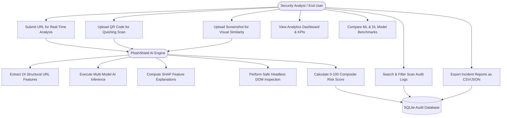
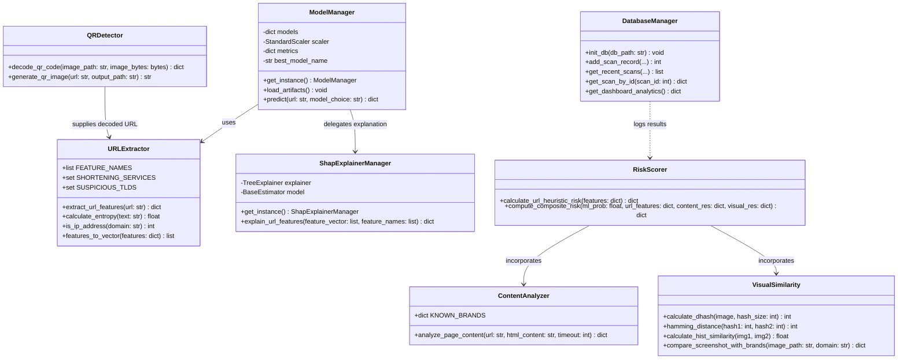
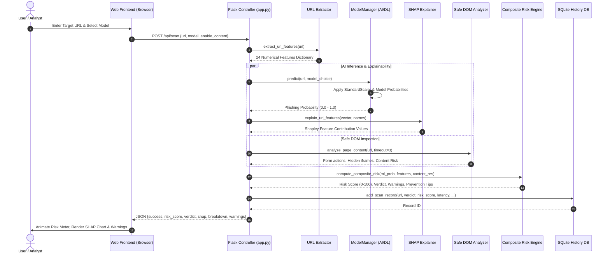
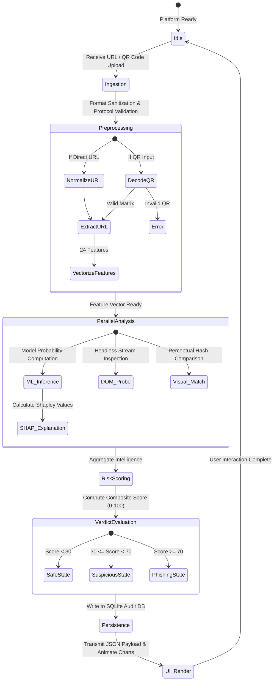
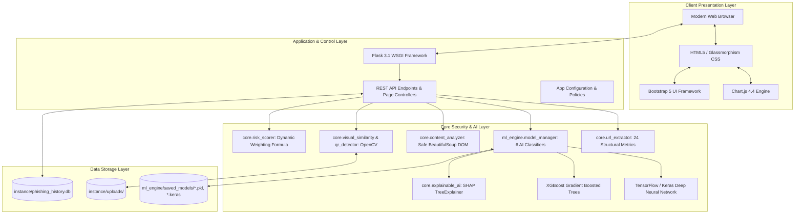

# UML Diagrams Specification

This document provides formal Unified Modeling Language (UML) structural and behavioral diagrams for the **AI for Phishing Website Detection System**.

---

## 1. Use-Case Diagram
Represents user and system actor interactions within the security detection framework.

---

## 2. Class Diagram
Represents the modular object-oriented architecture of the platform.

---

## 3. Sequence Diagram (Real-Time URL Scan Lifecycle)
Illustrates chronological execution across frontend, web controllers, feature extractors, AI engines, and database.

---

## 4. State Machine Diagram (Scan State Lifecycle)
Depicts the state transitions of a scan operation from initiation to report generation.

---

## 5. Component Diagram
Illustrates physical and logical module dependencies across the tech stack.

